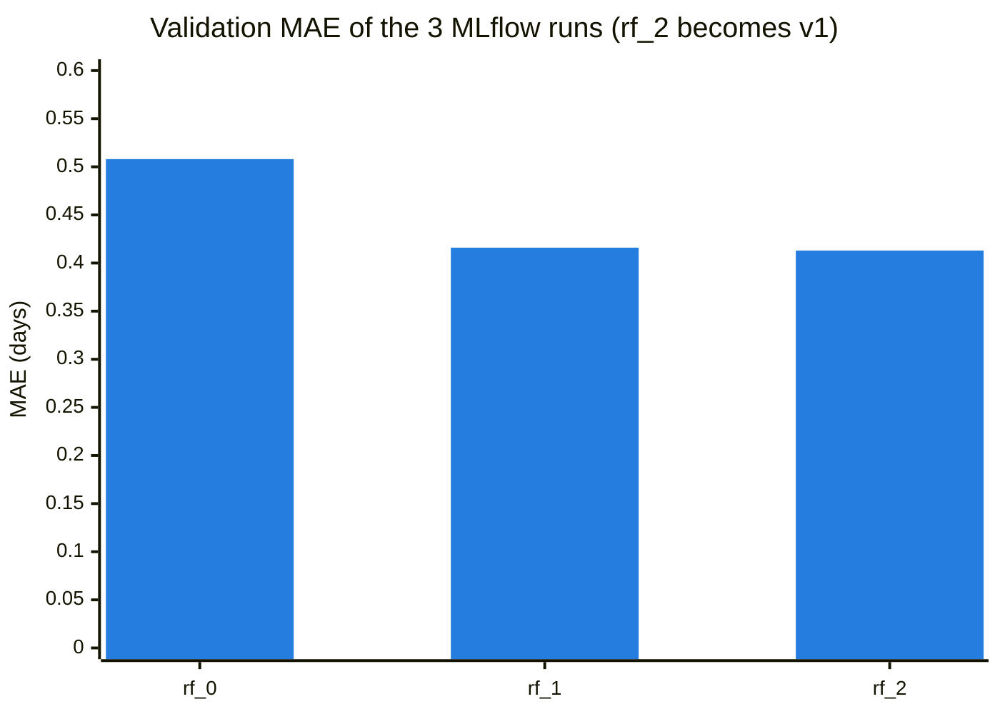
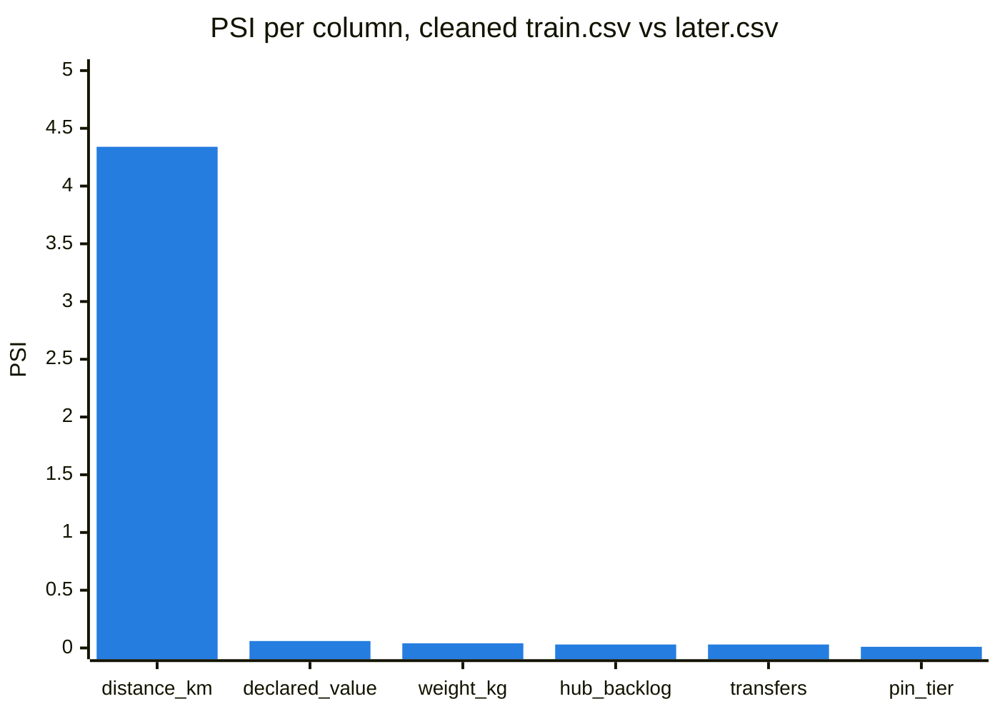
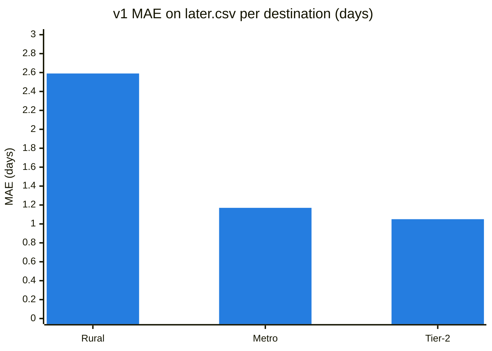
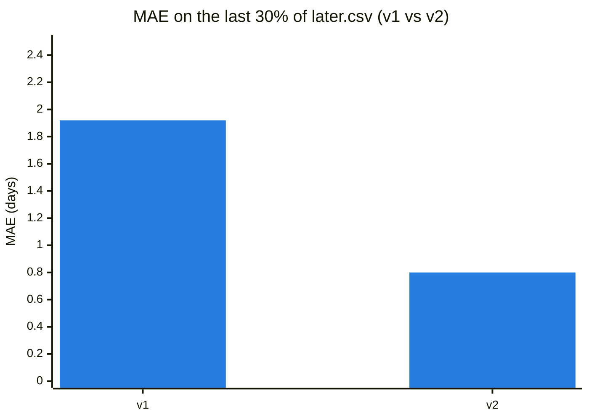
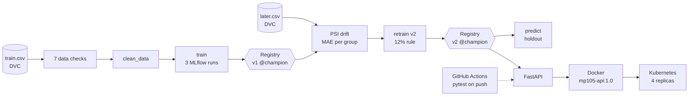

<h1 align="center">📦 Parcel Delivery Days — Bhopal</h1>

<p align="center">
  <b>An end-to-end MLOps pipeline for Bhopal Speed Parcel Hub</b><br>
  <sub>G027 · MP105 · SCSE3040 MLOps mini project</sub>
</p>

<p align="center">
  <a href="https://github.com/Saurav021406/G027-mp105-mlops/actions/workflows/ci.yml"></a>
  
  
  
  
  
  
  
</p>

<p align="center">
  <a href="#-the-problem">Problem</a> ·
  <a href="#-results-at-a-glance">Results</a> ·
  <a href="#-how-it-works">How it works</a> ·
  <a href="#-the-7-data-problems">Data problems</a> ·
  <a href="#-quick-start">Quick start</a> ·
  <a href="#-the-prediction-service">API</a> ·
  <a href="#-docker-and-kubernetes">Deploy</a> ·
  <a href="#-team">Team</a>
</p>

---

## 🎯 The problem

**Bhopal Speed Parcel Hub** promises delivery dates that are often wrong. We predict
**`delivery_days`** (days from booking to delivery) for every parcel, so that promised dates are
honest and slow lanes can be found and fixed.

It is a **regression** problem, scored with **MAE**: the average size of a mistake, in days.

| Data file | Rows | What it is |
|---|---|---|
| `train.csv` | 1,038 (1,000 after cleaning) | January to June 2026. Messy: typed by many people. |
| `later.csv` | 300 | July and August 2026. Arrived after the model went live. |
| `holdout_features.csv` | 250 | September 2026. No target; we predict it at the end. |

## 📊 Results at a glance

| 🏆 Best v1 MAE | 🌊 Biggest drift | 🚀 v2 vs v1 | 🔮 Predictions |
|:---:|:---:|:---:|:---:|
| **0.413** days | **distance_km**<br>PSI 4.34 | **58.5%** lower MAE<br>v2 promoted | **250** rows<br>holdout file |

**1. Three MLflow runs: the best one becomes v1**



| Run | Trees | Max depth | Validation MAE |
|---|---|---|---|
| rf_0 | 50 | 5 | 0.508 |
| rf_1 | 100 | 10 | 0.416 |
| **rf_2 (v1)** | **200** | **none** | **0.413** |

**2. Drift: only `distance_km` moved** (PSI above 0.25 means significant drift)



**3. v1 serves Rural deliveries worst**



**4. v2 clears the client's 12% rule by a wide margin**



> **Reading the story:** two months after launch, parcels travelled very different distances
> (`distance_km` drifted far past the 0.25 "significant" mark). v1 struggled most on **Rural**
> deliveries. Retraining on `train.csv` plus the first 70% of `later.csv` cut the error on the
> held-back last 30% from **1.92 to 0.80** days, far beyond the client's rule of "promote only if
> at least 12% better", so **v2 became the `@champion`**.

## 🧭 How it works



| Stage | What we built | Where |
|---|---|---|
| **Data** | DVC tracking, 7 data-problem checks, cleaning code | [`data_checks.py`](src/parcel_days/data_checks.py), [`clean.py`](src/parcel_days/clean.py) |
| **Tracking** | 3 MLflow runs (each logs `data_sha256` and a MAE metric), model registry, `@champion` alias | [`train.py`](src/parcel_days/train.py), `mlflow.db` |
| **Serving** | FastAPI with the client's two rules inside the schema, JSON logs on stdout | [`app/main.py`](app/main.py) |
| **Packaging** | Docker image and Kubernetes manifests | [`Dockerfile`](Dockerfile), [`k8s/`](k8s) |
| **Automation** | pytest on every push with GitHub Actions | [`ci.yml`](.github/workflows/ci.yml) |
| **Monitoring** | PSI per column, MAE per destination | [`monitor.py`](src/parcel_days/monitor.py), [`evaluate.py`](src/parcel_days/evaluate.py) |
| **Retraining** | v2 on train + first 70% of later, the 12% promotion rule | [`retrain.py`](src/parcel_days/retrain.py) |
| **Prediction** | Champion model on the holdout file | [`predict.py`](src/parcel_days/predict.py) |

## 🔎 The 7 data problems

Every answer below is produced by code in [`data_checks.py`](src/parcel_days/data_checks.py) and recorded in
[`reports/findings.yaml`](reports/findings.yaml).

| # | Problem | Found | Details |
|---|---|:---:|---|
| 1 | Leaking column | ❌ | Only the target is missing from the holdout file |
| 2 | Unit mix-up | ✅ | `weight_kg` for **Metro** is in grams (factor **1000**) |
| 3 | Sentinel value | ❌ | No impossible repeated number |
| 4 | Duplicate rows | ✅ | **38** extra copies |
| 5 | Stuck sensor | ✅ | `declared_value_rs` stuck at 19805 from **2026-05-10** to **2026-05-27** (107 rows) |
| 6 | Target typos | ✅ | **14** rows with `delivery_days` typed 10× too big |
| 7 | Spelling variants | ✅ | `service` written 18 different ways, **3** real levels: express, standard, economy |

All fixes live in [`clean.py`](src/parcel_days/clean.py) and are covered by tests in [`tests/`](tests).

## 🚀 Quick start

```bash
git clone https://github.com/Saurav021406/G027-mp105-mlops.git
cd G027-mp105-mlops
pip install -r requirements.txt
```

Put the original `train.csv` and `later.csv` from the course zip into `data/raw/`. They are tracked by DVC and
are not stored in git. Never open them in Excel: saving changes the file hash.

```bash
# Windows (cmd)              # Linux / macOS
set PYTHONPATH=src;.         export PYTHONPATH=src:.
```

| Step | Command |
|---|---|
| Run the tests | `python -m pytest tests -v` |
| Run the 7 data checks | `python src/parcel_days/data_checks.py` |
| Train v1 (3 MLflow runs) | `python -m parcel_days.train` |
| PSI drift | `python -m parcel_days.monitor` |
| v1 MAE per destination | `python -m parcel_days.evaluate` |
| Retrain v2 and apply the 12% rule | `python -m parcel_days.retrain` |
| Predict the holdout file | `python -m parcel_days.predict` |
| Browse experiments | `mlflow ui --backend-store-uri sqlite:///mlflow.db` |

> `train` and `retrain` each create new model versions in the registry, so run each one once.

## 🌐 The prediction service

```bash
uvicorn app.main:app --port 8000
```

Open <http://localhost:8000/docs> for the interactive page.

**`GET /health`** returns `{"status": "ok"}`

**`POST /predict`**

```bash
curl -X POST http://localhost:8000/predict \
  -H "Content-Type: application/json" \
  -d '{"distance_km": 1200, "weight_kg": 10.5, "hub_backlog": 2500,
       "pin_code_tier": 2, "declared_value_rs": 8000, "transfers": 3,
       "service": "express", "destination": "Metro"}'
```

The response is `{"prediction": <days>}`.

The client's two rules live in the request schema, so a bad request gets **422** and never reaches the model:

| Rule | Rejected input |
|---|---|
| `distance_km` above 4500 is impossible | `"distance_km": 5000` |
| `transfers` below 0 is a typing mistake | `"transfers": -1` |

Every prediction writes **one JSON log line to stdout** (never to a file, no personal details).

## 🐳 Docker and Kubernetes

```bash
docker build -t mp105-api:1.0 .
docker run -p 8000:8000 mp105-api:1.0
kubectl apply -f k8s/
```

| Thing | Value |
|---|---|
| Image | `mp105-api:1.0` on `python:3.12-slim`, dependencies installed before the code is copied |
| Deployment | `mp105-api`, **4 replicas**, container port 8000 |
| Service | `mp105-svc`, port 80 forwarding to 8000 |
| Probes | readiness and liveness on `/health` (liveness waits longer) |

## 📁 Repository layout

```
├── app/main.py                 FastAPI service (/predict, /health)
├── src/parcel_days/
│   ├── data_checks.py          the 7 data-problem checks
│   ├── clean.py                cleaning code
│   ├── train.py                v1 training, MLflow tracking and registry
│   ├── monitor.py              PSI drift
│   ├── evaluate.py             MAE per destination
│   ├── retrain.py              v2 and the 12% promotion rule
│   └── predict.py              holdout predictions
├── tests/                      pytest tests, including TestClient tests for the API
├── data/raw/                   *.dvc files (CSVs are tracked by DVC, not git)
├── models/                     champion model used by the API
├── k8s/                        deployment.yaml, service.yaml
├── .github/workflows/ci.yml    CI
├── reports/findings.yaml       the filled findings form
├── predictions/                holdout_predictions.csv
├── mlflow.db                   MLflow tracking database and model registry
├── params.yaml                 settings read by the code
├── Dockerfile
└── requirements.txt
```

## 👥 Team

**Group G027** · Problem **MP105** · Faculty: Amit Soni · Batch 69

| Enrolment no. | Name | GitHub | Built |
|---|---|---|---|
| S24CSEU2576 | Kumar Saurav | [@Saurav021406](https://github.com/Saurav021406) | repo, DVC, cleaning, training, MLflow, API, CI, Kubernetes, drift and retraining |
| S24CSEU2606 | Urjita Jain | [@Urjitaa](https://github.com/Urjitaa) | duplicate and leakage checks |
| S24CSEU2605 | Lakshita Badlia | [@lakshitabadlia](https://github.com/lakshitabadlia) | spelling-variant check |
| S24CSEU0104 | Manan Garg | [@Manan7289](https://github.com/Manan7289) | stuck-sensor check |
| S24CSEU2604 | Ruhi Mishra | [@RuhiMishra2202](https://github.com/RuhiMishra2202) | sentinel check, config and requirements |

<p align="center"><sub>SCSE3040 MLOps mini project · Bennett University · Client: Bhopal Speed Parcel Hub (a made-up organisation)</sub></p>